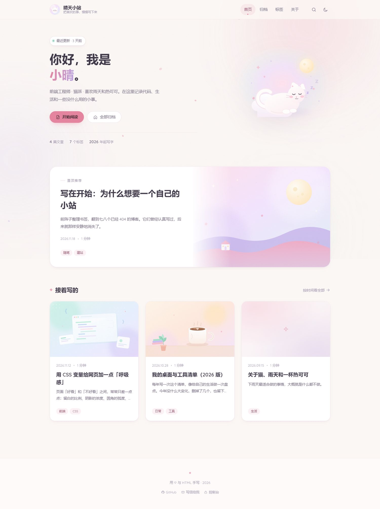
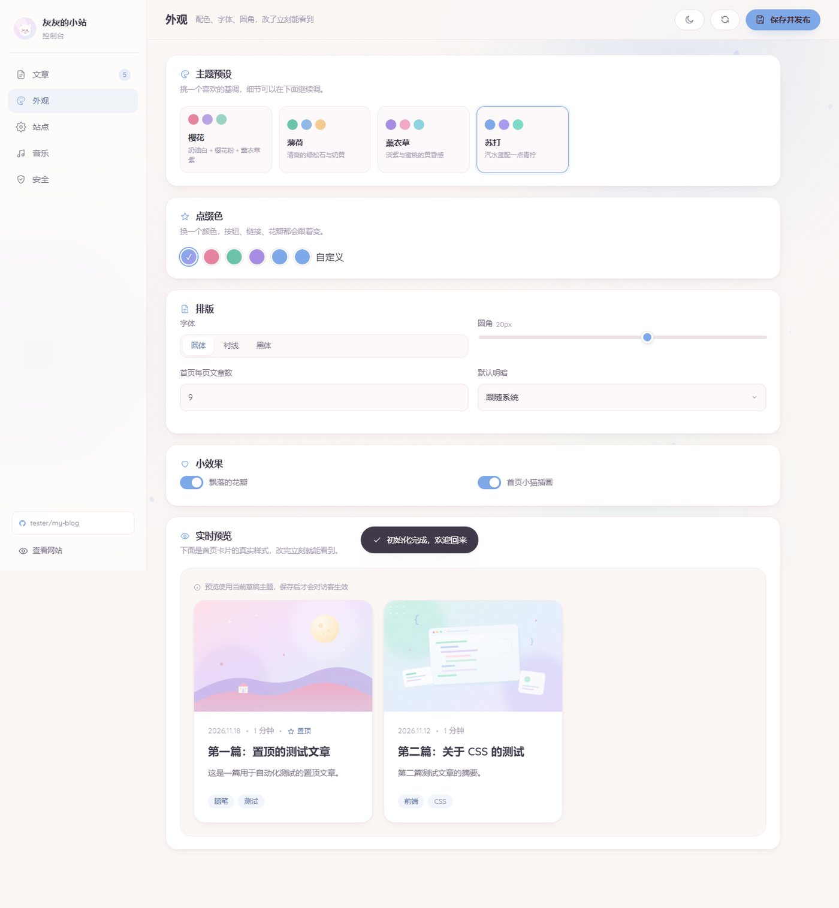
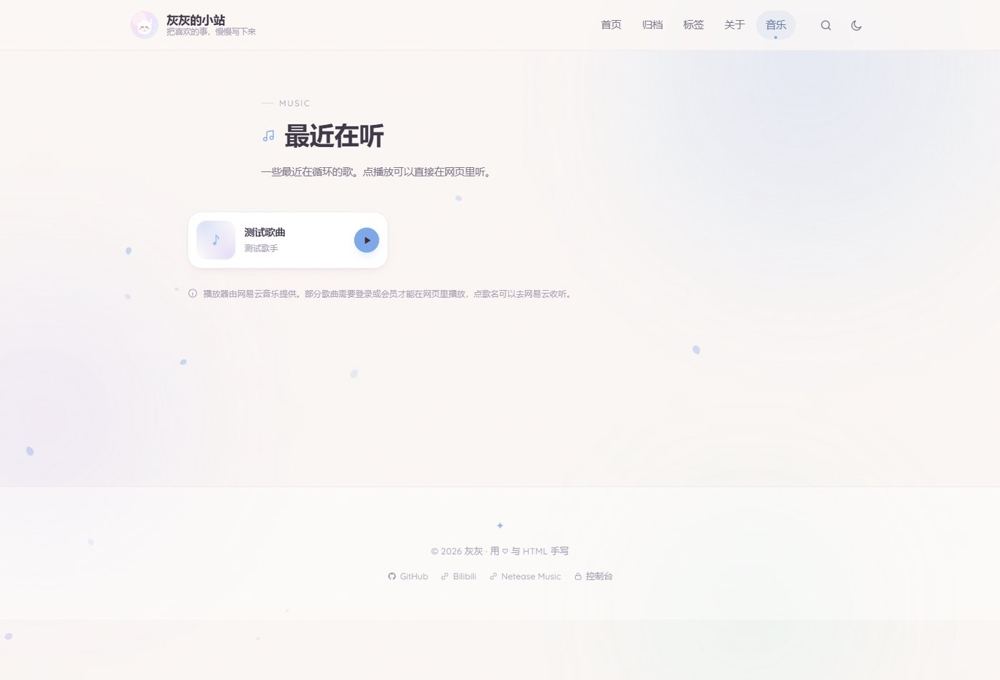
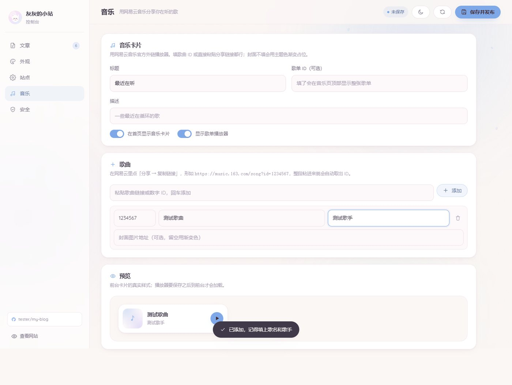
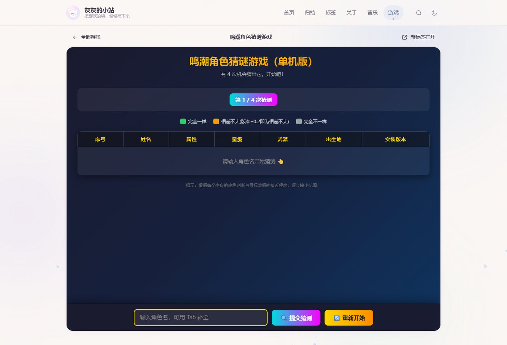
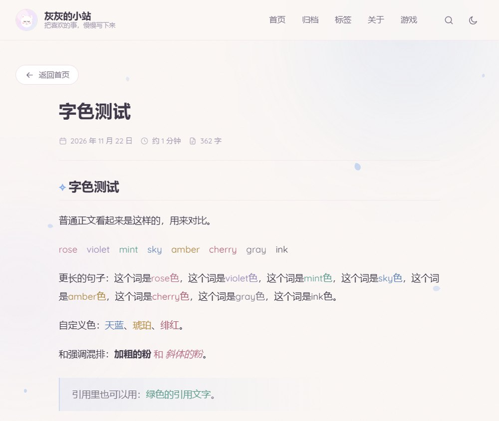

# 灰灰的小站

一个可以直接部署到 **GitHub Pages** 的静态博客：可爱但克制的樱花主题、自带密码保护的控制面板，写文章和调主题都在浏览器里完成。



## 它有什么

- **好看，而且能自己调**——樱花 / 薄荷 / 薰衣草 / 苏打四套配色，明暗双模，字体、圆角、每页文章数都能改，改完立刻在面板里预览
- **控制面板**——写 Markdown 文章、传封面图、管理标签、改站点信息、改导航和社交链接，全部图形界面
- **本地版控制台**——同一个面板跑在本机，直接改磁盘文件，改完一次性 `git commit`，不会每点一次保存就多一个提交
- **网易云音乐卡片**——粘一个分享链接就能把歌放进博客，支持单曲和整张歌单，文章正文里也能插
- **小游戏**——`#/games` 里挂了一个鸣潮角色猜谜；游戏是独立的 html，加新的只要放个文件
- **首次访问初始化密码**——密码只以 PBKDF2-SHA256（60 万次迭代）哈希保存在仓库里，不存明文，也无法反推
- **文章公开、面板上锁**——访客直接读页面，控制台必须输密码
- **纯静态零依赖**——没有构建步骤、没有 npm 依赖、没有后端，Push 完就能用；连字体都是自托管的
- **该有的都有**——归档、标签、关于、站内搜索（Ctrl/⌘ + K）、目录、阅读进度、代码高亮复制



---

## 你的仓库

| 对应地址 | URL |
| :-: | --- |
| 仓库 | `xiaohuihui1022/xiaohuihui1022.github.io` |
| 站点地址 | <https://xiaohuihui1022.github.io/> |
| 控制台 | <https://xiaohuihui1022.github.io/#/admin> |
| 分支 | `main` |

> 仓库名就是 `xiaohuihui1022.github.io`，所以它是「用户主页」，站点发布在域名根目录，不是 `/<仓库名>/` 子路径。

## 部署

### 1. 把文件推上去

仓库已经关联好了，直接推就行：

```bash
git push -u origin main
```

> 换成另一台电脑时，才需要先 `git remote add origin https://github.com/xiaohuihui1022/xiaohuihui1022.github.io.git`。

### 2. 初始化控制台

打开 <https://xiaohuihui1022.github.io/#/admin>

第一次进去会让你做两件事：**设置管理员密码**，以及**填一个 GitHub 访问令牌**。

令牌是这么来的：

1. 打开 <https://github.com/settings/personal-access-tokens/new>
2. **Repository access** 选 *Only select repositories*，选中 `xiaohuihui1022.github.io`
3. **Permissions → Repository permissions → Contents** 设为 **Read and write**
4. 生成后复制那串 `github_pat_...`（只显示一次）

填进去点「完成初始化」。它会先验证令牌确实能写这个仓库，再把密码哈希写进 `content/site.json`。

> **为什么第一次必须填令牌？** 因为初始化要把密码哈希写进仓库，而写仓库需要令牌。
> 也就是说：**没有你令牌的人无法抢先设置密码**——陌生访客最多只能看到一个设置页面，点不动。

之后每次进控制台，只要输密码；令牌只保存在**当前浏览器**里，换设备时再输一次即可（仓库里永远不会有它）。

---

## 控制台怎么用

| 分区 | 能做什么 |
| --- | --- |
| **文章** | 新建 / 编辑 / 删除 / 置顶 / 存草稿。左边写 Markdown，右边实时预览；封面可以直接上传（自动压到 1600px 宽、转 WebP，存进 `assets/uploads/`）；工具栏的 ♪ 插音乐卡片、**A** 给文字上色 |
| **外观** | 四套预设配色、任意点缀色、字体（圆体 / 衬线 / 黑体）、圆角大小、明暗默认值、花瓣和小猫插画开关、每页文章数，底部有真实卡片的实时预览 |
| **站点** | 站点名、副标题、作者、签名、头像、描述、页脚文字、关于页面（Markdown）、导航菜单、社交链接 |
| **音乐** | 粘贴网易云分享链接添加歌曲（自动取出 ID），填歌名/歌手/封面；可设置整张歌单；带真实卡片预览 |
| **安全** | 改密码、换仓库、测试连接、清除本机令牌、退出 |

改完点右上角 **「保存并发布」**（或 `Ctrl/⌘ + S`），它会：

1. 把你改动的文件提交到仓库（`content/site.json` 和/或 `content/posts.json`）
2. GitHub Pages 自动重新部署，**通常 30–60 秒后访客就能看到**
3. 面板里的预览是即时的，不用等部署

没保存就关页面会提示你；切换分区时如果有未保存的修改也会先问你。

---

## 本地控制台（一次提交）

需要nodejs环境

网页版每点一次「保存并发布」就会产生一次提交（改了主题又改了文章就是两次）。如果你想「改完一批再一起提交」，用本地版：

```bash
node scripts/console.mjs
```

也可以直接用`localconsole.bat`启动本地控制台

它会启动 `http://127.0.0.1:8787` 并自动打开 `/console`。里面是**同一套面板**，区别只在保存方式：

| | 网页版 | 本地版 |
| --- | --- | --- |
| 读写对象 | GitHub 仓库（contents API） | 本机磁盘上的 `content/*.json` |
| 密码 | `content/site.json` 里的 PBKDF2 哈希 | **同一份**，直接复用，不用重设 |
| 令牌 | 需要（存在浏览器里） | **不需要**，推送走你本机的 git 凭据 |
| 保存 | 立即提交，一次一个 commit | 只写文件，点「提交」才生成**一个** commit |
| 生效 | 等 Pages 部署 30–60 秒 | 本地立刻能看到（点「查看网站」） |

流程：**改 → 保存到本地（可以反复）→ 提交**。提交对话框里会列出这次要提交的文件，填好提交信息，勾选「顺便推送」就会顺带 `git push`。

- 密码和网页版共用，在本地改密码并提交后，网页版也用新密码
- 「忘记密码」的重置方式一样：把 `site.json` 里的 `auth` 改成 `null`
- 端口被占就换一个：`node scripts/console.mjs 8899`
- 服务只监听 `127.0.0.1`，每次启动生成一个临时令牌，别的网页调不动它的接口

## 音乐卡片

在控制台「音乐」里，把网易云的分享链接整段粘进去：

```
https://music.163.com/song?id=1234567
```

会自动取出 `1234567`，再填上歌名、歌手（封面不填就用主题色渐变占位）。

- 首页出现「最近在听」区块（默认取前三首）；有音乐后，导航会自动多出一个「音乐」
- 单独的音乐页 `#/music` 列出全部歌曲；填了歌单 ID 的话，页面顶部会显示整张歌单的播放器
- 点播放会把网易云官方外链播放器嵌进卡片，同一时间只放一首，再点一次停止
- 歌名可点，会跳到网易云对应页面

> 外链播放器由网易云提供：部分歌曲需要登录或会员才能在网页里播放，这个站绕不过去。放不出来时点歌名去网易云听就好。

### 在文章里插一张

写文章时点工具栏上的 ♪ 按钮，选一首已经添加的歌（或直接粘贴链接），会插入一行：

```
{{music:1234567}}
```

保存后，这一行就会变成一张可以直接播放的音乐卡片。渲染时会去「音乐」列表里找这首歌的歌名/歌手/封面；找不到就退化成一张通用的「网易云音乐 · 歌曲 ID」卡片，照样能播。





---

## 弗一把

`#/games` 是游戏列表，点进去用 iframe 打开游戏本身；顶栏那一条可以新标签全屏打开。现在里面有一个《鸣潮角色猜谜游戏》（`phrolova.html`）。



导航里的「游戏」会**自动出现**（和「音乐」一样，不用手动加导航项）。想再加一个：

1. 把游戏的 html 放到根目录（自包含最好，外部依赖都放 `assets/`）
2. 在 `assets/js/views.js` 的 `GAMES` 数组里加一条：`{ slug, title, desc, file, tag }`

---

## 正文里的字色

Markdown 本身没有字色，这里加了一个轻量标记：`{颜色|文字}`。



- **预设颜色**：`rose` 粉 / `violet` 紫 / `mint` 绿 / `sky` 蓝 / `amber` 黄 / `cherry` 红 / `gray` 灰 / `ink` 墨
- **任意颜色**：`{#6f9fe0|天蓝}`，写 `#rgb`、`#rrggbb`、`#rrggbbaa` 都行
- 可以套在加粗、斜体里，也能用在列表、引用、表格中
- 颜色会**自动适配明暗模式**：浅色下偏深、深色下偏亮，不会出现「白底白字」

编辑器工具栏最右边的 **A** 按钮可以直接给选中的文字上色（点色块即可），选「去掉颜色」能还原。

```markdown
这篇里有一个 {rose|粉色的词}，还有 {#6f9fe0|自定义蓝}。
```

> 小提示：颜色是用来点睛的。整段都上色反而会显得吵，也很难保证对比度。

---

## 安全是怎么设计的

这套东西跑在纯静态托管上，所以安全模型跟有后端的博客不一样，值得花一分钟了解：

**密码**
- 只保存 `PBKDF2-SHA256(password, salt, 600000 次)` 的结果，16 字节随机盐，存在 `content/site.json` 的 `admin.auth` 里
- 600,000 次迭代意味着每次尝试都要算上几十万个哈希；配合一个 14 位以上的密码，离线爆破基本没有意义
- 密码本身不写进任何地方，**忘了就只能重置**（见下）

**令牌**
- GitHub 令牌只存在浏览器的 `localStorage`（键名 `blog.gh.token`）
- 它**绝不写进仓库**，也不会发给任何第三方；只用来调用 GitHub 的接口
- 换设备 / 换浏览器 / 清理浏览器数据后，需要重新输入令牌

**权限**
- 令牌建议用 Fine-grained，并且只授权这一个仓库的 `Contents: Read and write`
- 即使令牌泄露，损失范围也仅限于这一个仓库

**内容**
- 渲染 Markdown 时会转义所有 HTML，文章里写 `<script>` 不会被当作代码执行
- 站点配置里的文本同样转义后再插入页面

> 顺带说明：`admin.auth` 是公开可见的（仓库公开、页面公开）。这没问题——它只是一个需要海量计算才能反推的哈希。真正防止别人动你内容的是「写仓库需要令牌」这件事。

### 忘记密码了怎么办

1. 打开 GitHub 上这个仓库的 `content/site.json`
2. 把 `"auth": { ... }` 整段（包含里面的 `hash`、`salt`、`iterations`）改成 `"auth": null`
3. 提交，等 Pages 部署完
4. 刷新 `#/admin`，会重新进入初始化流程，设置新密码

因为初始化需要令牌，所以不用担心别人趁这个空档抢走控制台。

---

## 本地预览

需要 Node.js（18+）。不需要安装任何依赖：

```bash
node scripts/serve.mjs 5173
# 打开 http://127.0.0.1:5173/
```

> 浏览器只在 **https** 或 **localhost / 127.0.0.1** 下提供密码学接口（WebCrypto），
> 所以别用 `file://` 直接打开 `index.html`，控制台的密码功能会不可用。

想跑自动化自测（用系统 Edge + 模拟 GitHub 接口，不会碰真仓库）：

```bash
pnpm install                 # 只装 playwright-core 这一个开发依赖
node scripts/qa.mjs          # 网页版：48 项检查 + 截图到 .shots/
node scripts/test-console.mjs  # 本地版：在临时目录里跑真实的 git 提交
```

`qa.mjs` 用内置的测试文章，所以站点里有没有内容都不影响。
`test-console.mjs` 会把项目复制到临时目录、造一个 git 仓库再跑，你的仓库不会被改动。

截图会输出到 `.shots/`。

---

## 目录结构

```
.
├─ index.html            单页入口（前台 + 网页版控制台）
├─ console.html          本地控制台的壳（由 scripts/console.mjs 注入令牌后返回）
├─ phrolova.html         鸣潮角色猜谜游戏（`#/games` 里通过 iframe 打开）
├─ 404.html              找不到页面时的提示
├─ content/
│  ├─ site.json          站点配置 + 主题 + 音乐 + 密码哈希 + 仓库信息
│  └─ posts.json         全部文章
├─ assets/
│  ├─ css/style.css      前台样式（设计令牌都在 :root）
│  ├─ css/admin.css      控制台样式
│  ├─ js/app.js          路由、渲染、搜索、音乐播放、花瓣、阅读进度
│  ├─ js/admin.js        控制面板（网页版和本地版共用）
│  ├─ js/console.js      本地控制台入口（把读写对象换成磁盘 + git）
│  ├─ js/auth.js         PBKDF2 密码哈希
│  ├─ js/github.js       GitHub 接口封装
│  ├─ js/markdown.js     轻量 Markdown 渲染器
│  ├─ js/theme.js        主题预设与 CSS 变量
│  ├─ js/views.js        页面片段
│  ├─ img/               头像、插画、封面
│  └─ fonts/             自托管字体
├─ scripts/
│  ├─ serve.mjs          本地预览静态服务
│  ├─ console.mjs        本地控制台服务（只监听 127.0.0.1）
│  ├─ qa.mjs             网页版端到端测试 + 截图
│  └─ test-console.mjs   本地控制台端到端测试（在临时目录里跑，不碰你的仓库）
└─ .nojekyll             告诉 GitHub Pages 不要跑 Jekyll
```

想手改也可以：`content/*.json` 就是全部内容，格式很直白。改完直接 commit 一样生效。

---

## 一些常见问题

**改了内容多久生效？**
GitHub Pages 一般 30–60 秒。没生效就等一会儿，或者强制刷新（`Ctrl/⌘ + Shift + R`）。

**填令牌时提示 `Resource not accessible by personal access token`？**
说明令牌权限不够。检查两处：

1. **Repository access** 要选 *Only select repositories* 并勾上 `xiaohuihui1022.github.io`。
   默认的 *Public repositories (read-only)* 只能读，写不了。
2. **Permissions → Repository permissions → Contents** 要选 **Read and write**，下拉默认是 **Read-only**。

改完权限以后**必须重新生成令牌**——已经发出去的令牌不会自动升级权限。换上新令牌再点一次「验证并进入」就好。

**可以绑定自己的域名吗？**
可以。仓库 Settings → Pages → Custom domain 填域名，然后在域名服务商加一条 CNAME 指向 `xiaohuihui1022.github.io`。这个站所有路径都是相对的，换域名不用改代码。

**文章存在哪？会不会丢？**
存在 `content/posts.json`，跟着 Git 走。每次保存都是一次提交，历史版本永远能翻回来。

**能多人一起写吗？**
可以，但需要共享同一个管理员密码（内容都是公开的，谁都能看）。不建议把密码给不熟的人——他们能改你整个站。

**文章里的图片呢？**
上传的图会提交到 `assets/uploads/`。也可以直接在 Markdown 里写外链图片，这里推荐imgur。

**为什么不用现成的博客框架 / CMS？**
现成主题大多不能从浏览器里改样式，常规 CMS（比如 Decap）又依赖 OAuth 服务、也没有「首次访问设置密码」这件事。所以这里做了一套极简的：静态页面 + 浏览器端提交到 GitHub，不引入任何服务端。

**支持哪些 Markdown 语法？**
标题、段落、粗体斜体删除线、行内代码、围栏代码块、引用、有序/无序列表（可嵌套）、表格、分隔线、链接、图片（带图注）、裸链接自动识别，以及 `{{music:歌曲ID}}` 音乐卡片和 `{rose|文字}` 字色标记。

**移动端能写吗？**
能打开和编辑，但手机上写长文体验一般，建议还是用电脑。

**网易云卡片点播放是白框？**
外链播放器是 `music.163.com` 提供的 iframe，白框通常是网络被拦、歌曲需要登录/会员，或者浏览器拦截了第三方 Cookie。点歌名可以直接去网易云听。填了歌单 ID 的话，音乐页顶部会显示整张歌单的播放器，那个更稳一些。

**本地控制台和网页版能同时用吗？**
不建议同时开。两边改的是同一份 `content/*.json`：本地版写磁盘，网页版写 GitHub，谁后提交谁覆盖。平时用一个就好——想批量整理用本地版，随手改一篇用网页版。

**想换头像 / 插画呢？**
最简单是在控制台「站点 → 头像地址」里填一张图片的地址（也可以先传到 `assets/uploads/` 再填路径）。首页那只睡觉的小猫在 `assets/img/hero-cat.svg`，直接替换这个文件就行，或者在「外观」里关掉它。

**搜索引擎能收录吗？**
能，但因为是单页应用 + hash 路由，收录效果不如一篇一个 HTML 的多页站点。每个页面都有独立的 `title`、`description` 和 OG 标签，分享到社交平台会有正常的标题和摘要。如果你很在意 SEO，可以在 `scripts/` 里加一个生成静态页的脚本，但那就需要构建步骤了——这个站刻意不做这件事。

---

## 技术细节

- 零构建、零运行时依赖；ES Modules + CSS 自定义属性，现代浏览器直接跑
- 路由用 hash（`#/post/xxx`），所以 GitHub Pages 上不需要任何 rewrite 规则，也不会 404
- 主题通过 `data-mode` / `data-preset` / `data-font` 属性和 CSS 变量切换，颜色用 `color-mix()` 派生
- 密码：WebCrypto `PBKDF2` + `SHA-256`，600,000 次迭代，32 字节输出
- 样式里的所有圆角、间距、颜色都来自 `:root` 的令牌，想大改风格从那里下手最快

---

用 ♡ 和 HTML 手写。随便改，改成你自己的样子。
